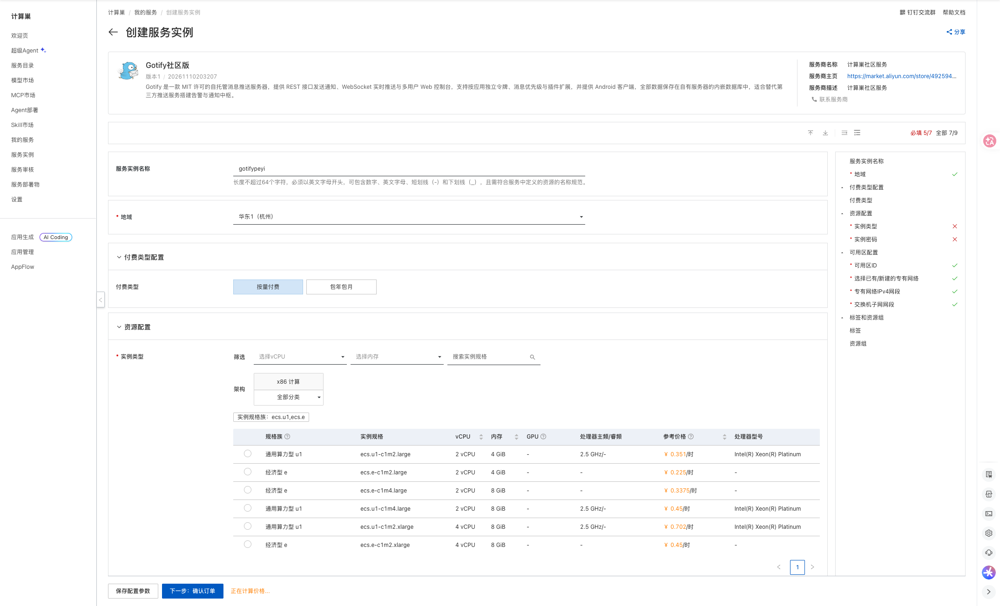
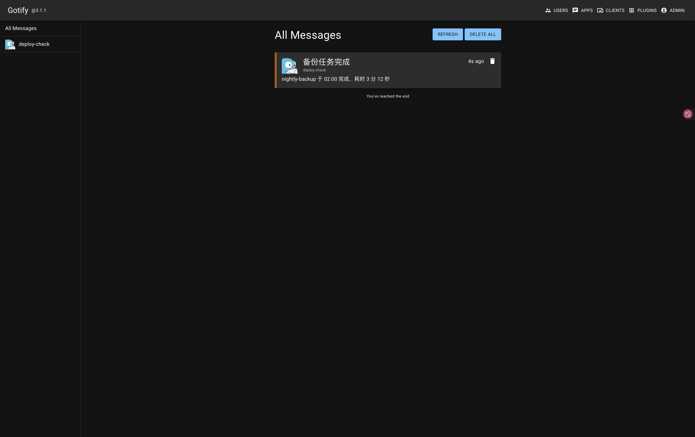

# Deploying Gotify on Alibaba Cloud Compute Nest

## About the service

Gotify is an MIT-licensed, self-hosted push notification server. It exposes a REST endpoint for sending messages, pushes them over WebSocket to a multi-user web console, and supports per-application tokens, message priorities and plugins. Scripts, monitoring, CI and IoT devices send notifications with an application token; the web console and the Android client receive them, and all data stays on your own server.

This Compute Nest service deploys a single ECS instance. The image already contains Gotify and its Docker Compose runtime, and both messages and accounts live in a local SQLite database on the instance.

Gotify is served on port 80 of the instance public IP. Opening the address shows the sign-in page; the username is always `admin` and the initial password is listed in the service instance outputs.

## Billing

Creating a service from this template is free. Running a service instance incurs:

- ECS instance (minimum 2 vCPU, 4 GiB memory)
- System disk (fixed at 200 GiB ESSD by the template)
- Public bandwidth (fixed at 5 Mbps by the template)

Both pay-as-you-go and subscription are supported; the estimate is shown before you confirm the order.

## Required RAM permissions

If you create the instance with a RAM user, grant the following policies first.

| Policy | Purpose |
| --- | --- |
| AliyunECSFullAccess | Manage ECS instances |
| AliyunVPCFullAccess | Manage VPC resources |
| AliyunROSFullAccess | Manage Resource Orchestration Service stacks |
| AliyunComputeNestUserFullAccess | Manage Compute Nest user-side resources |

## Deployment steps

1. Open the instance creation page, choose a region, and specify the instance type and instance password. You can create a new VPC or use an existing VPC and vSwitch.

   [Deploy now](https://computenest.console.aliyun.com/service/instance/create/cn-hangzhou?type=user&ServiceId=service-72a1e942e6704966bccc)

   

2. Review the price estimate, choose **Next: Confirm Order**, accept the service agreement and click **Create Now**.

3. Wait for the deployment to finish. The **Outputs** section of the instance details page lists `gotify_80_url`, `AdminUsername` and `AdminPassword`, plus notes on message sending, security defaults, data persistence and single sign-on that are worth reading.

4. Open the URL from the outputs (`http://<public-ip>`), sign in as `admin` with the generated password and reach the console.

## First steps

### Create an application and send your first message

Open **APPS** and click **CREATE APPLICATION** (for example `nightly-backup`) to get a push token for that application. Then run this from any machine that can reach the instance:

```bash
curl "http://<public-ip>/message?token=<app-token>" \
  -H "Content-Type: application/json" \
  -d '{"title":"Backup finished","message":"nightly-backup completed at 02:00 in 3m12s","priority":5}'
```

The token can also be sent in the `X-Gotify-Key` header. The console receives the message over WebSocket in real time.



### Connect clients

The official Gotify Android client can be pointed at the instance URL plus an application token. The console supports multiple users, so you can add team accounts under **USERS** and keep the admin account separate.

### Data persistence

All state lives in `/opt/gotify/data` on the system disk (the SQLite file `gotify.db` plus the `images` and `plugins` directories). `docker compose down` and container rebuilds keep the data; releasing the instance deletes it, so back up that directory regularly. In SQLite mode the upstream project caps the open connection count at 1, so write operations are serialized; watch disk headroom and write latency when message volume is high.

### Change the admin password

`GOTIFY_DEFAULTUSER_PASS` only applies when the database is first created; editing it later or redeploying does not override an existing account. To change the password, sign in and use the user menu. To reset to a fresh account, run `cd /opt/gotify && docker compose down` on the instance, clear `/opt/gotify/data`, then `docker compose up -d` (all history is lost).

### Security defaults

Public registration is disabled, local authentication stays on, server-side TLS is off and the session cookie is not marked Secure (required for plain HTTP delivery). The container runs unprivileged with capability dropping and `no-new-privileges`, and the host Docker socket is not mounted. To enable registration, edit `/opt/gotify/.env` and run `cd /opt/gotify && docker compose up -d`; exposing registration publicly lets any visitor create an account and is not recommended.

### Enable OIDC single sign-on

OIDC support is built in (`GOTIFY_OIDC_ENABLED`, false by default) and works with providers such as Authelia, Dex and Keycloak. The provider must support PKCE and the callback address must end with `/auth/oidc/callback`. Once enabled, the IdP group claim takes over admin rights on every sign-in and overrides manual changes, so evaluate this before turning it on.

## Parameters

| Parameter | Description | Default |
| --- | --- | --- |
| VpcOption | Create a new VPC or reuse an existing one | NewVPC |
| VpcCidrBlock | CIDR block of the new VPC | 192.168.0.0/16 |
| VSwitchCidrBlock | CIDR block of the new vSwitch | 192.168.1.0/24 |
| EcsInstanceType | ECS instance type, 2–4 vCPU ecs.u1 / ecs.e families | none |
| InstancePassword | Password for the ECS instance | none |
| PayType | Billing method | PostPaid |
| ZoneId | Availability zone | none |
| VpcId / VSwitchId | Existing VPC and vSwitch (when reusing a VPC) | empty |

## Outputs

| Output | Description |
| --- | --- |
| gotify_80_url | Gotify URL (port 80) |
| AdminUsername | Admin username (`admin`) |
| AdminPassword | Generated admin password |
| QuickStartGuide / PushMessageUsage | Sign-in and message sending notes |
| SecurityDefaultsNote / HttpDeliveryNote | Factory security defaults and plain HTTP limits |
| DataPersistenceNote / PasswordChangeNote | Data persistence and password change notes |
| SsoCapabilityNote | OIDC single sign-on notes |

## Security notes

- The instance is delivered over plain HTTP on a public IP without a domain or TLS. If you put a TLS reverse proxy in front, also set `GOTIFY_SERVER_SECURECOOKIE` to true and list the proxy in `GOTIFY_SERVER_TRUSTEDPROXIES`, otherwise the real client IP is lost; make sure WebSocket upgrades are not truncated.
- An application token grants send rights for that application. Do not embed it in front-end code or public repositories.
- For an internet-facing push server, restrict source IPs where possible and review the USERS and APPS lists regularly.
- All data lives under `/opt/gotify/data` on the system disk and is deleted with the instance.

## Troubleshooting

**Sign-in says the username or password is wrong.** The username is `admin` and the password is the `AdminPassword` output value (or the password you changed it to). A reused data directory keeps its old password.

**curl returns 401 or 403.** 401 means the application token is wrong or deleted; check it on the APPS page. 403 usually means the path is wrong: send to `/message?token=<token>` or use the `X-Gotify-Key` header.

**No real-time messages in the console.** WebSocket needs a direct connection to the instance; if a reverse proxy sits in between, make sure it allows the WebSocket upgrade.

## Links

- Source code: https://github.com/gotify/server
- Documentation: https://gotify.net/docs
- License: MIT
