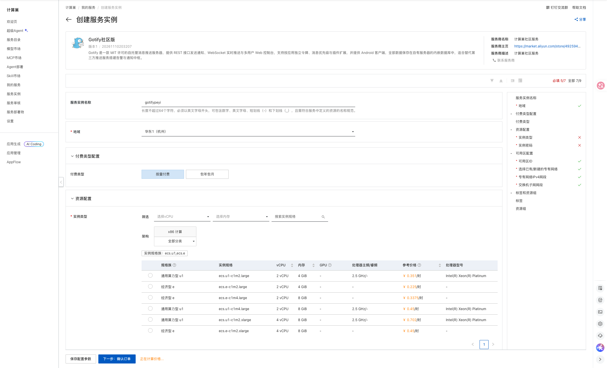
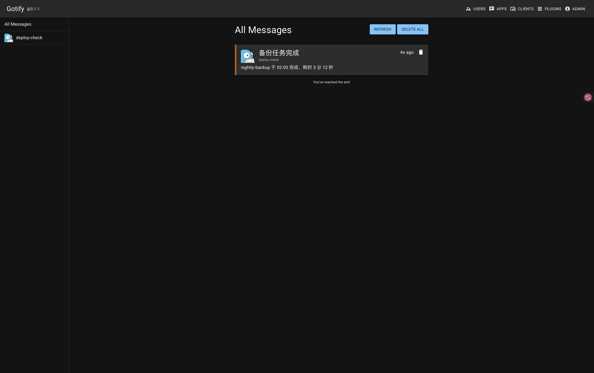

# Gotify 计算巢部署文档

## 服务说明

Gotify 是一款 MIT 许可开源自托管的推送消息服务器：提供 REST 接口发送通知、WebSocket 实时推送到多用户 Web 控制台，并支持按应用独立令牌、消息优先级与插件扩展。脚本、监控、CI、IoT 设备都可以用应用令牌向它发消息，Web 控制台和 Android 客户端负责接收，全部数据保存在自己的服务器上，适合替代第三方推送服务搭建内部告警与通知中心。

本计算巢服务采用单机 ECS 部署，ECS 镜像内已预置 Gotify 与 Docker Compose 运行环境，消息与账号数据保存在实例本机的 SQLite 数据库中。

访问入口为实例公网 IP 的 80 端口。打开地址即进入登录页，用户名固定为 `admin`，初始密码在服务实例输出中查看。

## 计费说明

通过此服务模板构建服务不产生费用。用户部署服务实例时，资源费用主要涉及：

- ECS 实例规格（最低 2 vCPU、4 GiB 内存）
- 系统盘容量（模板固定 200 GiB ESSD）
- 公网带宽（模板固定 5 Mbps）

计费方式支持按量付费和包年包月，预估费用会在部署前实时展示。

## RAM账号所需权限

若使用 RAM 用户创建服务实例，需要在创建服务实例前为该 RAM 用户添加相应权限。

| 权限策略名称 | 备注 |
| --- | --- |
| AliyunECSFullAccess | 管理云服务器 ECS 的权限 |
| AliyunVPCFullAccess | 管理专有网络 VPC 的权限 |
| AliyunROSFullAccess | 管理资源编排 ROS 的权限 |
| AliyunComputeNestUserFullAccess | 管理计算巢服务用户侧资源的权限 |

## 服务实例部署流程

### 部署步骤

1. 打开计算巢服务实例创建页面，选择部署地域，填写实例规格、实例密码。网络可选择新建 VPC，也可以选择已有的 VPC 与交换机。

   [部署链接](https://computenest.console.aliyun.com/service/instance/create/cn-hangzhou?type=user&ServiceId=service-72a1e942e6704966bccc)

   

2. 确认询价明细后点击 **下一步：确认订单**，同意服务协议并点击 **立即创建**。

3. 等待服务实例部署完成。部署完成后，在服务实例详情页的 **输出** 区域查看 `gotify_80_url` 访问地址、`AdminUsername` 用户名与 `AdminPassword` 管理员密码；输出中还有推送调用、安全默认值、数据持久化与单点登录等说明，建议一并阅读。

4. 用浏览器打开输出中的访问地址（`http://<实例公网IP>`），使用用户名 `admin` 与输出中的管理员密码登录，进入控制台。

## 首次使用说明

### 1. 创建应用并发送第一条消息

登录后进入 **APPS** 页，点击 **CREATE APPLICATION** 新建一个应用（例如 `nightly-backup`），即可获得该应用的推送令牌。随后在任意能访问实例的机器上执行：

```bash
curl "http://<实例公网IP>/message?token=<应用令牌>" \
  -H "Content-Type: application/json" \
  -d '{"title":"备份任务完成","message":"nightly-backup 于 02:00 完成，耗时 3 分 12 秒","priority":5}'
```

也可以把令牌放在 `X-Gotify-Key` 请求头里。消息发出后，控制台会通过 WebSocket 实时收到。



### 2. 客户端接入

Android 可安装 Gotify 官方客户端，填入实例访问地址与应用令牌即可在手机上收推送。控制台本身支持多用户，可在 **USERS** 页为团队成员创建各自账号，管理员账号另行保留。

### 3. 数据持久化

全部状态保存在系统盘的 `/opt/gotify/data` 目录（SQLite 库文件 `gotify.db`，以及 `images` 与 `plugins` 两个子目录）。执行 `docker compose down` 或重建容器不会丢数据；释放实例即全部丢失，请定期备份该目录。SQLite 模式下上游把最大打开连接数限制为 1，消息量很大时建议关注磁盘余量与写入延迟。

### 4. 修改管理员密码

`GOTIFY_DEFAULTUSER_PASS` 只在数据库首次创建时生效，之后改动该变量或重新部署都不会覆盖已有账号。如需改密，登录后在用户菜单中修改即可；若要重置为全新账号，需要在实例上执行 `cd /opt/gotify && docker compose down`、清空 `/opt/gotify/data` 后重新 `docker compose up -d`（会丢失全部历史消息）。

### 5. 安全默认值

出厂已关闭公开注册、保持本地鉴权开启、关闭服务端 TLS 并保持会话 Cookie 不带 Secure 标记（纯 HTTP 交付所必需）；容器已做能力裁剪与 `no-new-privileges` 加固，未挂载宿主 Docker socket，非特权运行。如需开放注册，可编辑 `/opt/gotify/.env` 后执行 `cd /opt/gotify && docker compose up -d`，但公网开放注册等于允许任意访客自建账号，不建议。

### 6. 启用 OIDC 单点登录

该版本内置 OIDC 支持（`GOTIFY_OIDC_ENABLED`，出厂为 false），可对接 Authelia、Dex、Keycloak 等身份提供方，要求对方支持 PKCE，回调地址需以 `/auth/oidc/callback` 结尾。启用后 IdP 的组声明会在每次登录时接管管理员权限并覆盖手工改动，请评估后再开启。

## 参数说明

| 参数 | 说明 | 默认值 |
| --- | --- | --- |
| VpcOption | 网络类型，新建 VPC 或使用已有 VPC | NewVPC |
| VpcCidrBlock | 新建 VPC 的网段 | 192.168.0.0/16 |
| VSwitchCidrBlock | 新建交换机的网段 | 192.168.1.0/24 |
| EcsInstanceType | ECS 实例规格，可选 2–4 vCPU 的 ecs.u1 / ecs.e 系列 | 无 |
| InstancePassword | 实例登录密码 | 无 |
| PayType | 付费类型 | PostPaid |
| ZoneId | 可用区 | 无 |
| VpcId / VSwitchId | 已有 VPC 与交换机 ID（选择已有 VPC 时填写） | 空 |

## 输出说明

| 输出 | 说明 |
| --- | --- |
| gotify_80_url | Gotify 访问地址（端口 80） |
| AdminUsername | 管理员用户名（admin） |
| AdminPassword | 系统随机生成的管理员密码 |
| QuickStartGuide / PushMessageUsage | 登录与推送调用说明 |
| SecurityDefaultsNote / HttpDeliveryNote | 出厂安全默认值与明文 HTTP 交付限制 |
| DataPersistenceNote / PasswordChangeNote | 数据持久化与密码修改方式 |
| SsoCapabilityNote | OIDC 单点登录能力说明 |

## 安全与使用说明

- 实例以公网 IP 加明文 HTTP 交付，未配置域名与 TLS。若自行在前面加 TLS 反向代理，必须同时把 `GOTIFY_SERVER_SECURECOOKIE` 改为 true 并把代理地址写入 `GOTIFY_SERVER_TRUSTEDPROXIES`，否则取不到真实客户端 IP，并需保证 WebSocket 升级不被截断。
- 应用令牌等同于该应用的发送权限，不要写进前端代码或公开仓库。
- 公网暴露的推送服务建议按需限制来源 IP，并定期检查 USERS 与 APPS 列表。
- 所有数据保存在系统盘 `/opt/gotify/data`，释放服务实例会一并删除，请提前备份。

## 常见问题

**登录提示用户名或密码错误？**
用户名固定为 `admin`，密码在服务实例输出的 `AdminPassword` 中。如果之前改过密码或复用了旧数据目录，请使用修改后的密码。

**curl 推送返回 401 或 403？**
401 表示应用令牌错误或已删除，请到 APPS 页重新确认令牌；403 通常说明请求路径不对，推送应发往 `/message?token=<令牌>` 或使用 `X-Gotify-Key` 请求头。

**控制台收不到实时消息？**
WebSocket 需要直连实例，若中间加了反向代理，请确认代理放行了 WebSocket 升级。

## 官方链接

- 官方仓库：https://github.com/gotify/server
- 官方文档：https://gotify.net/docs
- 许可证：MIT
